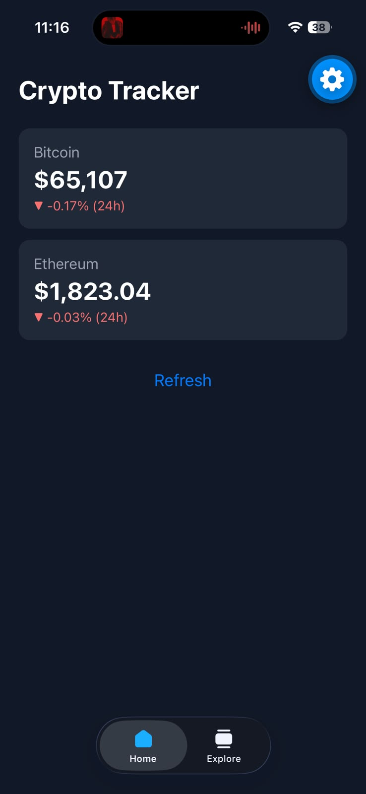

# Crypto Tracker



A React Native mobile app that shows live Bitcoin and Ethereum prices. Built with Expo and TypeScript as my first React Native project.

## Features

- Live USD prices for Bitcoin and Ethereum from the CoinGecko public API
- 24-hour price change shown in green (up) or red (down)
- Refresh button to load the latest prices
- Loading indicator and error message if the request fails

## Tech Stack

- React Native
- Expo
- TypeScript
- CoinGecko API

## How to Run

1. Install Node.js (LTS) and the Expo Go app on your phone.
2. Download this repository and open the folder in a terminal.
3. Install dependencies:

```
npm install
```

4. Start the app:

```
npx expo start
```

5. Scan the QR code with Expo Go.

## What I Learned

- Building screens with React Native components and styles
- Fetching data from an API with async/await
- Managing loading, error and data states with React hooks (useState, useEffect)

## Notes

The home screen is in `src/app/index.tsx`. Other starter files come from the Expo project template.
